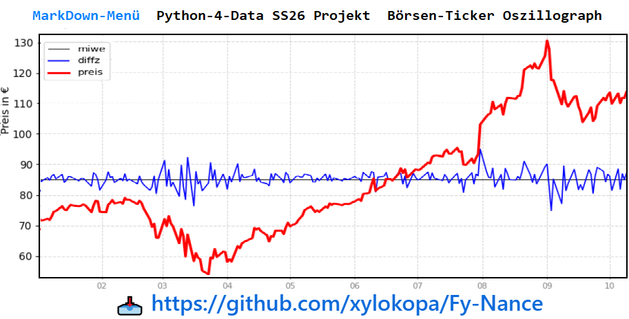
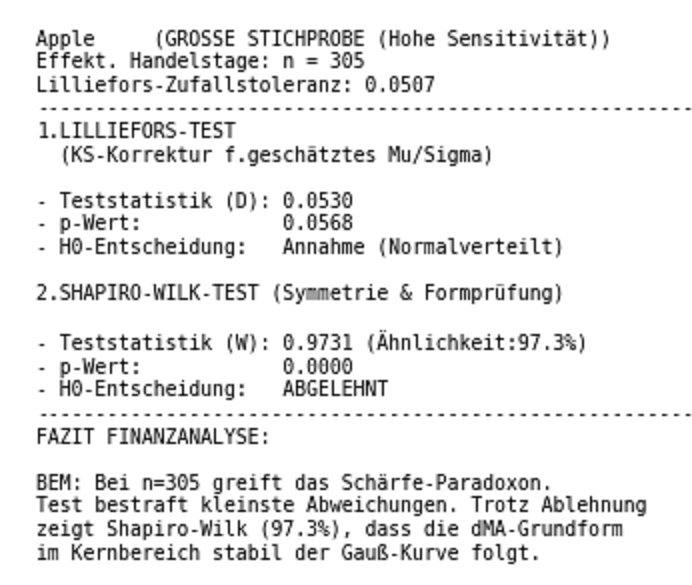

# 📈 Xylokopa's Github 
Willkommen auf Xylokopa's Github-Website. Hier werden UNI-Projekte  
Revue passiert, anstatt auf meiner Festplatte zu verstauben.
---
## 🚀 Projekt 1: Fy-Nance (Juli 2026)
Dieses Projekt entstand als Kurs-Projekt im Sommersemester 2026. Es kombiniert 
Kurs-Diagramme mit Daten-Tests am Beispiel von Tickern wie z.B APPLE (`AAPL`).

  

### Kernkomponenten & Programme
* **[Hauptprogramm Börsen-Oszillograph](PY/BOszi_Projekt.py):** Python-Code zur Analyses von Live-Tickern.
* **[Interaktives Jupyter Notebook](IPYNB/Oszi_03n_290626.ipynb):** Einbettung als Notebook.
* **[Streamlit Web-App](fy_nance_app.streamlit.app.py):** Code der interaktiven Live-App.

### 🎮 Interaktive Live-App (Direkt ausprobieren)
Online live zu bedienen. Nutze die Regler auf der linken Seite, um Zeiträume und das Moving-Average-Fenster anzupassen:

<iframe src="https://fy-nance-app.streamlit.app?embed=true" width="100%" height="700px" style="border: 1px solid #ccc; border-radius: 8px"></iframe>

### Dokumentation & Analysen
* 📄 [Python-Script-Dokumentation (PDF)](PDF/BOszi_03.pdf)
* 📊 [PCA-Ressourcen & Theorie zur Hauptkomponentenanalyse (PDF)](PDF/PCA-Data-ressources.pdf)

### Visueller Eindruck
Auszug der berechneten Statistiken aus dem Projekt:

----------------------------------------------------------------------------------------------
* Ab hier Stand der Dinge WS26 ...*

  

### Numerik 
* 📄 [Keplersche Fassregel und Runge-Kutta (PDF)](Kepler-Runge-Kutta.pdf)
----------------------------------------------------------------------------------------------
## 🚏 Die Albatros-Flight-Map

"Flugplan"-skizze und geschätzte Projektphasen

* **Zeitraum:** Nov/Dez 2026

### Phase 1: Flugdaten ausbauen
* **Status:** Vorbereitet (GPX-Rohdaten aus St-Auban/Hangwindsegeln Authon/Auribeau aus den Jahren 2012 und 2015).
* **Nächster Schritt:** XML-Struktur als Flugdaten-Tabelle mit Zeilenzähler.
* **Übergabeparameter:** `[Zeilennummer] -> [lon_x, lat_y, ele_z, time_t]`.

### Phase 2: Gelände einbeziehen
* **Status:** Mathematische Grundidee : Einbettung eines einfachen Geländemodells
* **Leitlinie:** Umrechnung Erdkrümmung und Längengrad-Stauchung in einen euklidischen XYZ-Koordinatenquader 
                 mittels dimensionsloser Abszissen-Anpassung: x.cos(lat)
* **Ziel:** Projektion der Flugspur in ein anschauliches, händisch skalierbares 3D-Schrägbilddiagramm ohne "Heavy Rendering".

### Phase 3: Wechselwirkung von Wind und Gelände zwischen null und abstandsabhängig
* **Paradigma:** "Melken" eines Hangwindes bzw. einer Wellenkamm-Linie unter 45°.
* **Mathematischer Ansatz:** Lineare Approximation (evtl. auch 2.ten Grades) des Gelände-Netzes ( à la Cavalieri geschichtet  ). 
* **Steuergrössen:** Bewegung in x- bzw. y-Richtung entspr. in der Realität entstandener Flugdaten 
* **Zustandsänderung:** Resultierendes Steigen in z-Richtung vor der Felswand (bzw. über der Wasseroberfläche) bei abstandsabhängig
                        gedämpftem Aufwind der sich bei Annäherung ans Geländenetz annulliert 
                     
### Phase 4: Gespeicherte reale Flugbahnen mit rechnerisch modellierten einander gegenüber stellen
* **Zeitraum:** Jan/Feb 2027.
* **Ziel:** Einsatz von Python,um bei vorgegebener xy-Flugspur mit im einfachsten Modell zumindest konstanter Gleitzahl von Ort zu Ort 
            die geschätzte nächste Flugposition mit der tatsächlich beobachteten zu vergleichen und abzugleichen.Modellverfeinerung mit
            übergang zu einer variablen Gleitzahl anhand geeignet zu definierender variabler Parameter und deren Implementierung...

### 🎮 Interaktiver Flugdaten-Auswertungstests zum Üben 
Hier kannst du die Flugdaten die darunter angeboteten videos in den Diagrammen mit der Maus abtasten. 

<iframe src="Auswertung01.html" width="100%" height="700px" style="border: 1px solid #ccc; border-radius: 8px"></iframe>

<iframe width="900" height="675" src="https://www.youtube-nocookie.com/embed/23Xh0o5LPak" allow="autoplay"></iframe>

<iframe src="Auswertung02.html" width="100%" height="700px" style="border: 1px solid #ccc; border-radius: 8px"></iframe>

<iframe width="900" height="675" src="https://www.youtube-nocookie.com/embed/OXInR2Cl6a0" allow="autoplay"></iframe>

---Status: So 08-Nov-2026...*

