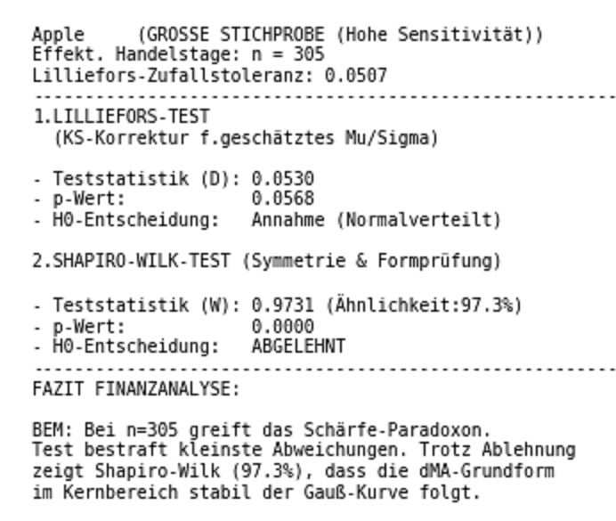

# 📈 Xylokopa's Github 

Willkommen auf Xylokopa's digitaler Litfaßsäule. Hier werden UNI-Projekte
vom vergangenen Semester Revue passiert, anstatt auf meiner Festplatte zu 
verstauben.

---

## 🚀 Projekt 1: Fy-Nance (Juli 2026)
Dieses Projekt entstand als Kurs-Projekt im Sommersemester 2026. Es kombiniert 
datengestützte Finanzanalyse mit numerischen Modellen am Beispiel von Ticker-
Daten wie z.B APPLE (`AAPL`).

### Kernkomponenten & Programme
* **[Hauptprogramm Börsen-Oszillograph](PY/BOszi_Projekt.py):** Der zentrale Python-Code zur Berechnung der Modelle.
* **[Interaktives Jupyter Notebook](IPYNB/Oszi_03n_290626.ipynb):** Die mathematische Herleitung und Schritt-für-Schritt-Analyse.
* **[Streamlit Web-App](streamlit_app/fy_nance_app.streamlit.app.py):** Der Code für die interaktive Benutzeroberfläche.

### Dokumentation & Analysen
* 📄 [Vollständige Python-Script-Dokumentation (PDF)](PDF/BOszi_03.pdf)
* 📊 [PCA-Ressourcen & Theorie zur Hauptkomponentenanalyse (PDF)](PDF/PCA-Data-ressources.pdf)

### Visueller Eindruck
Hier ein Auszug der berechneten Statistiken aus dem Projekt:

---
*Hier entsteht ab Dezember 2026 ein neues Projekt...*
